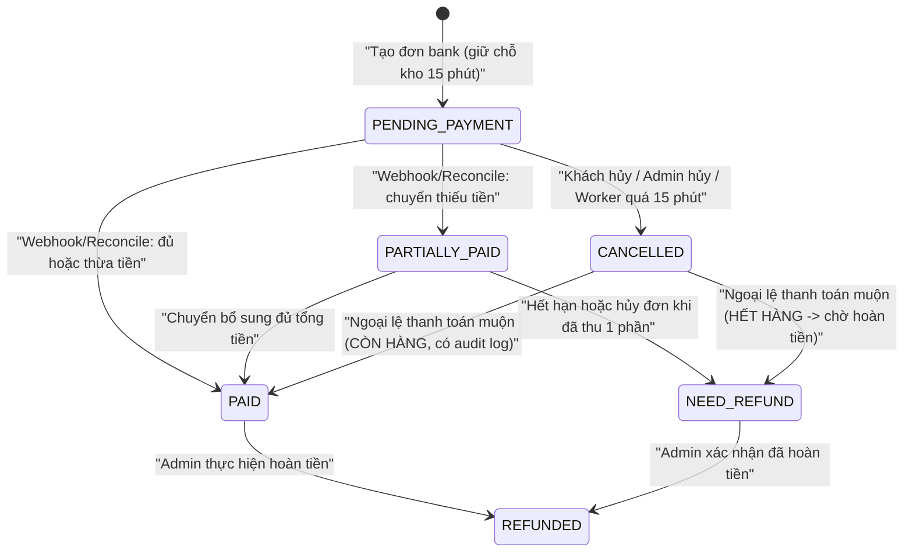
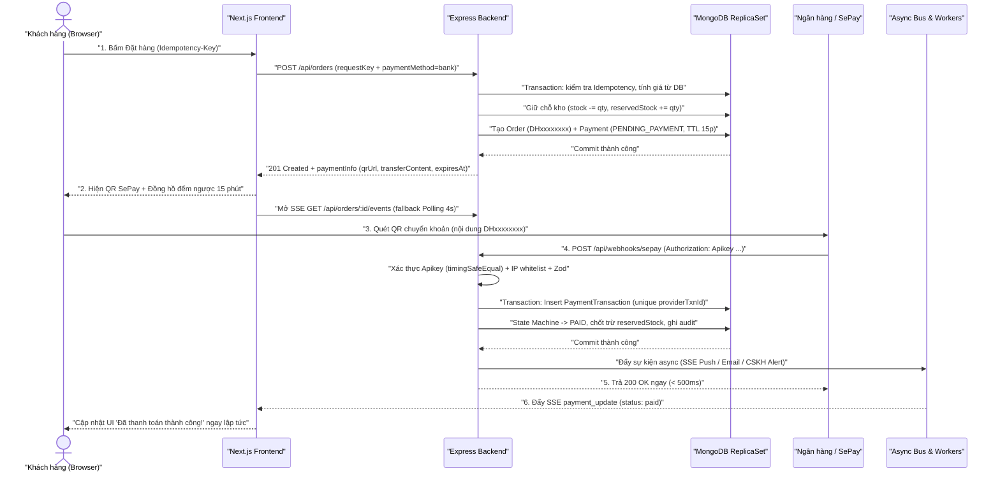

# Thiết Kế Chức Năng Thanh Toán Tự Động Qua SePay Webhook & State Machine

**Ngày lập:** 2026-11-21  
**Trạng thái:** Chờ phê duyệt (Draft Spec)  
**Phạm vi:** Monorepo `backend/` (Express 5 + Mongoose 9 + MongoDB Replica Set) & `frontend/` (Next.js 15)

---

## 1. Mục Tiêu, Phạm Vi & Nguyên Tắc Bất Biến (Goals, Non-Goals & Core Invariants)

### 1.1. Mục tiêu (Goals)
1. **Thanh toán chuyển khoản tự động qua SePay Webhook**: Khách hàng đặt hàng chọn thanh toán ngân hàng sẽ nhận mã **VietQR động** kèm mã đơn hàng duy nhất (`orderCode`, ví dụ `DH6B017BC6`). Khi khách chuyển khoản, SePay bắn webhook tới Backend để tự động đối soát, cập nhật trạng thái thanh toán/đơn hàng và thông báo cho trình duyệt theo thời gian thực.
2. **Máy trạng thái tập trung (Centralized State Machine)**: Mọi thay đổi trạng thái thanh toán và đơn hàng bắt buộc đi qua một hàm chuyển đổi tập trung duy nhất, bảo đảm tính hợp lệ của vòng đời đơn hàng và ghi vết kiểm toán đầy đủ.
3. **Giữ chỗ tồn kho tạm thời (Stock Reservation 15 phút) & Chống Overselling**: Đảm bảo không bao giờ bán âm kho khi nhiều khách đặt hàng đồng thời, đồng thời không để đơn ảo "giam" hàng vĩnh viễn nhờ cơ chế hết hạn giữ chỗ sau 15 phút.
4. **Xử lý toàn diện các trường hợp biên (Edge Cases)**: Trùng lặp webhook, chuyển thiếu tiền, chuyển thừa tiền, sai nội dung chuyển khoản (giao dịch treo), thanh toán muộn sau khi đơn đã hủy, webhook trễ/thất lạc (Cronjob đối soát định kỳ), bảo mật chữ ký/API Key & IP whitelist, phản hồi webhook nhanh tránh timeout.
5. **Tương thích ngược tuyệt đối**: Giữ nguyên hợp đồng API và đảm bảo toàn bộ **90 bài test hiện có** trong `backend/tests/**/*.test.js` tiếp tục pass 100%.

### 1.2. Phạm vi loại trừ (Non-Goals & Quy định bắt buộc)
- **Tuyệt đối KHÔNG tạo nút "Giả lập Webhook" trên giao diện (Frontend/Admin UI)**: Không dựng bất kỳ nút bấm hay route UI nào cho phép giả lập webhook SePay. Mọi kiểm thử đều thực hiện bằng bộ test tự động (`node:test` + `supertest`), webhook thật từ SePay, hoặc công cụ gọi HTTP chuyên dụng bên ngoài (như Postman/curl có kèm API Key).
- **Không thay đổi nghiệp vụ COD**: Đơn thanh toán khi nhận hàng (`paymentMethod: 'cod'`) giữ nguyên luồng trừ `stock` trực tiếp khi đặt đơn và `paymentStatus: 'unpaid'`.

### 1.3. Nguyên tắc bất biến hệ thống (Core Invariants)
1. **Tiền tệ là số nguyên VNĐ tuyệt đối**: Không sử dụng `FLOAT` hoặc `DOUBLE` ở bất kỳ tầng nào (Frontend, API, Service, Database). Mọi giá trị tiền (`subtotal`, `discount`, `shippingFee`, `total`, `expectedAmount`, `paidAmount`, `overpaidAmount`, `transferAmount`) đều là số nguyên không âm (`Number.isSafeInteger(v) && v >= 0`, đơn vị đồng VNĐ).
2. **Backend là nguồn chân lý duy nhất về giá (Server-side Price Calculation)**: Backend đọc đơn giá sản phẩm trực tiếp từ collection `Product` và tính toán lại toàn bộ `subtotal`, `discount`, `shippingFee`, `total` bên trong Database Transaction; tuyệt đối bỏ qua mọi giá trị tiền do Frontend gửi lên.
3. **Cổng chuyển trạng thái duy nhất (Single Source of Truth)**: Cấm tuyệt đối cập nhật tự do `status` hoặc `paymentStatus` bằng các câu lệnh `Order.updateOne` / `Payment.updateOne` rải rác. Mọi chuyển trạng thái thanh toán đều phải gọi qua `backend/src/services/paymentStateMachine.js`.

---

## 2. Thiết Kế Máy Trạng Thái Tập Trung (Centralized State Machine)

### 2.1. Hai lớp trạng thái đồng bộ (`Payment.status` ↔ `Order.paymentStatus`)
Để vừa triển khai mô hình thanh toán chặt chẽ vừa giữ tương thích ngược với API/UI/Test hiện hữu của `Order`:

| Trạng thái ở `Payment.status` | Giá trị ánh xạ ở `Order.paymentStatus` | Trạng thái đơn `Order.status` | Ý nghĩa nghiệp vụ |
| :--- | :--- | :--- | :--- |
| *(COD — không tạo Payment)* | `'unpaid'` | `pending` → `confirmed` → `shipping` → `delivered` | Thanh toán tiền mặt khi nhận hàng |
| `PENDING_PAYMENT` | `'pending'` | `'pending'` | Chờ khách chuyển khoản trong 15 phút (đang giữ chỗ tồn kho) |
| `PARTIALLY_PAID` | `'partially_paid'` | `'pending'` | Khách đã chuyển nhưng chưa đủ số tiền `total` (vẫn giữ chỗ tồn kho) |
| `PAID` | `'paid'` | `'confirmed'` (hoặc giữ `confirmed`+) | Đã thu đủ tiền (`paidAmount >= expectedAmount`), đã chốt trừ kho thật |
| `CANCELLED` | `'unpaid'` | `'cancelled'` | Khách hủy hoặc quá hạn 15 phút chưa thanh toán, đã nhả giữ chỗ kho |
| `NEED_REFUND` | `'need_refund'` | `'cancelled'` | Đơn đã hủy/hết hạn nhưng nhận tiền muộn lúc hết hàng, hoặc quá hạn khi đang `PARTIALLY_PAID` |
| `REFUNDED` | `'refunded'` | `'cancelled'` | Đã hoàn tiền xong cho khách (do Admin/Kế toán xác nhận) |

### 2.2. Sơ đồ chuyển đổi trạng thái (`stateDiagram-v2`)



### 2.3. Ma trận chuyển trạng thái tập trung (`paymentStateMachine.js`)
Module `backend/src/services/paymentStateMachine.js` cung cấp hàm trung tâm:

```js
transitionPaymentState(paymentId, targetState, context, session)
```

- **Bảng cho phép chuyển đổi chuẩn (`ALLOWED_TRANSITIONS`)**:
  - `PENDING_PAYMENT` → `['PAID', 'PARTIALLY_PAID', 'CANCELLED']`
  - `PARTIALLY_PAID` → `['PAID', 'NEED_REFUND']`
  - `PAID` → `['REFUNDED']`
  - `NEED_REFUND` → `['REFUNDED']`
  - `CANCELLED` → `['NEED_REFUND']` *(nhánh `CANCELLED → PAID` bị **cấm hoàn toàn** ở hàm chuyển đổi chuẩn; trả lỗi `409 INVALID_STATE_TRANSITION` nếu gọi trực tiếp)*
  - `REFUNDED` → `[]` *(trạng thái kết thúc)*

- **Quy tắc bảo vệ chuyển ngược `CANCELLED → PAID`**:
  - Hàm `transitionPaymentState` từ chối mọi yêu cầu chuyển từ `CANCELLED` sang `PAID`.
  - Việc khôi phục đơn đã hủy chỉ được thực hiện duy nhất qua hàm chuyên biệt `handleLatePaymentException(payment, txData, session)` (quy trình xử lý ngoại lệ có kiểm toán):
    1. Bắt buộc chạy bên trong MongoDB Transaction (`session.withTransaction`).
    2. Kiểm tra điều kiện nguyên tử với từng sản phẩm trong đơn (sắp xếp theo `productId` tăng dần): trừ lại `stock` nếu `stock >= item.quantity` (và xử lý tiêu thụ lại mã giảm giá nếu có).
    3. **Nếu kho ĐỦ hàng cho toàn bộ sản phẩm**: Cập nhật `Payment.status = 'PAID'`, `recoveredFromCancelled = true`, `Order.paymentStatus = 'paid'`, `Order.status = 'confirmed'`, ghi vào `stateHistory` với `reason: 'LATE_PAYMENT_RECOVERY'`.
    4. **Nếu bất kỳ sản phẩm nào KHÔNG ĐỦ hàng (hoặc mã giảm giá đã hết lượt)**: Hủy bỏ thao tác trừ kho (abort/không trừ bất kỳ mặt hàng nào), chuyển `Payment.status = 'NEED_REFUND'`, `Order.paymentStatus = 'need_refund'`, giữ nguyên `Order.status = 'cancelled'`, ghi `stateHistory` với `reason: 'LATE_PAYMENT_OUT_OF_STOCK'` và phát cảnh báo ưu tiên cao cho Admin/CSKH.

- **Nhật ký kiểm toán (`stateHistory`)**: Mỗi lần chuyển trạng thái thành công, đẩy thêm một bản ghi bất biến vào `Payment.stateHistory`:
  ```js
  {
    from: String,
    to: String,
    reason: String,        // vd: 'WEBHOOK_FULL_PAID', 'RESERVATION_EXPIRED', 'LATE_PAYMENT_RECOVERY'
    actor: String,         // 'system:webhook' | 'system:cron' | 'system:ttl_worker' | 'user:<id>' | 'admin:<id>'
    providerTxnId: String, // nullable
    amount: Number,        // nullable (VND)
    timestamp: Date
  }
  ```
- **Cập nhật có điều kiện (Atomic Guard)**: Lệnh cập nhật luôn kèm điều kiện trạng thái cũ `{ _id: payment._id, status: expectedFromStatus }` bên trong `session` để chặn triệt để 2 tiến trình song song chuyển trạng thái trùng lên nhau.

---

## 3. Thiết Kế Cơ Sở Dữ Liệu (MongoDB / Mongoose 9 Schemas)

### 3.1. Collection `products` (`backend/src/models/Product.js` — mở rộng)
Giữ nguyên toàn bộ trường hiện có, bổ sung:
- `reservedStock: { type: Number, required: true, default: 0, min: 0 }` — Tổng số lượng sản phẩm đang được giữ chỗ tạm thời bởi các đơn chuyển khoản ở trạng thái `PENDING_PAYMENT` / `PARTIALLY_PAID`.
- **Bất biến tồn kho (Stock & Reservation Accounting)**:
  - `stock` luôn là **số lượng khả dụng có thể đặt mua** (giữ nguyên ngữ nghĩa để toàn bộ bài test hiện có của `order-create.test.js`, `cart.test.js`, `product.test.js` tiếp tục đúng 100%).
  - Tổng tồn kho vật lý tại kho = `stock + reservedStock`.
  - Bảng biến động tồn kho theo từng sự kiện:

| Sự kiện | `stock` (Khả dụng) | `reservedStock` (Đang giữ chỗ) | Tổng vật lý (`stock + reservedStock`) |
| :--- | :---: | :---: | :---: |
| Tạo đơn **COD** (`qty`) | `- qty` | `0` | Giảm thật `qty` ngay |
| Hủy đơn **COD** (`qty`) | `+ qty` | `0` | Hoàn trả `qty` |
| Tạo đơn **Bank** (`qty`) | `- qty` | `+ qty` | **Không đổi** (chỉ giữ chỗ tạm 15 phút) |
| Đơn **Bank** chuyển sang **`PAID`** | `0` | `- qty` | **Chốt trừ tồn kho thật `qty`** |
| Đơn **Bank** hết hạn 15 phút / Hủy (`CANCELLED` hoặc `NEED_REFUND` từ `PARTIALLY_PAID`) | `+ qty` | `- qty` | **Không đổi** (nhả chỗ về `stock` cho khách khác mua) |
| Ngoại lệ thanh toán muộn đủ hàng (`LATE_PAYMENT_RECOVERY`) | `- qty` | `0` | Giảm thật `qty` |

### 3.2. Collection `orders` (`backend/src/models/Order.js` — mở rộng)
Giữ nguyên các trường và index hiện tại (`{ userId: 1, requestKey: 1 }` unique), bổ sung:
- `orderCode: { type: String, unique: true, sparse: true }` — Sinh ngay khi tạo đơn theo công thức `DH${String(_id).slice(-8).toUpperCase()}` (duy nhất, tra cứu $O(1)$ qua index).
- `paymentStatus`: mở rộng enum thành `['unpaid', 'pending', 'partially_paid', 'paid', 'need_refund', 'refunded']`.
- `paymentExpiresAt: { type: Date, default: null }` — Thời điểm hết hạn giữ chỗ (`createdAt + 15 phút`) đối với đơn `bank`; `null` đối với `cod`.
- `paidAmount: { type: Number, default: 0, min: 0 }` — Số tiền nguyên VNĐ đã thực nhận cho đơn hàng.
- `overpaidAmount: { type: Number, default: 0, min: 0 }` — Số tiền khách chuyển dư so với `total` (nếu có).

### 3.3. Collection `payments` (`backend/src/models/Payment.js` — mới)
Quản lý trạng thái tài chính và máy trạng thái của từng đơn hàng chuyển khoản:
- `orderId: { type: Schema.Types.ObjectId, ref: 'Order', required: true, unique: true }`
- `orderCode: { type: String, required: true, unique: true }`
- `userId: { type: Schema.Types.ObjectId, ref: 'User', required: true }`
- `provider: { type: String, enum: ['sepay'], default: 'sepay' }`
- `expectedAmount: { type: Number, required: true, min: 0 }` *(số nguyên VNĐ)*
- `paidAmount: { type: Number, required: true, default: 0, min: 0 }` *(số nguyên VNĐ)*
- `overpaidAmount: { type: Number, required: true, default: 0, min: 0 }` *(số nguyên VNĐ)*
- `status: { type: String, enum: ['PENDING_PAYMENT', 'PARTIALLY_PAID', 'PAID', 'CANCELLED', 'NEED_REFUND', 'REFUNDED'], required: true, default: 'PENDING_PAYMENT' }`
- `expiresAt: { type: Date, required: true }`
- `paidAt: { type: Date, default: null }`
- `refundedAt: { type: Date, default: null }`
- `refundNote: { type: String, default: '' }`
- `recoveredFromCancelled: { type: Boolean, default: false }`
- `stateHistory`: mảng `{ from, to, reason, actor, providerTxnId, amount, timestamp }`.
- **Indexes**: `{ status: 1, expiresAt: 1 }` (phục vụ Worker thu hồi đơn quá hạn nhanh $O(\log N)$) và `{ status: 1, createdAt: -1 }` (phục vụ Cronjob đối soát & danh sách ngoại lệ Admin).

### 3.4. Collection `payment_transactions` (`backend/src/models/PaymentTransaction.js` — mới)
Lưu vết bất biến mọi giao dịch tiền gửi từ SePay Webhook hoặc Cronjob đối soát:
- `providerTxnId: { type: String, required: true, unique: true }` — Map từ `String(payload.id)` (hoặc fallback `sepay-${referenceCode}-${transactionDate}`), **UNIQUE INDEX** ngăn xử lý trùng lặp ở mức cơ sở dữ liệu.
- `provider: { type: String, default: 'sepay' }`
- `source: { type: String, enum: ['webhook', 'reconcile_cron'], required: true }`
- `gateway: { type: String, default: '' }` *(ngân hàng phát sinh giao dịch từ SePay)*
- `accountNumber: { type: String, default: '' }`
- `transferType: { type: String, enum: ['in', 'out'], required: true }`
- `transferAmount: { type: Number, required: true, min: 0 }` *(số nguyên VNĐ)*
- `content: { type: String, default: '' }`
- `extractedOrderCode: { type: String, default: null }`
- `referenceCode: { type: String, default: '' }`
- `transactionDate: { type: Date, default: null }`
- `orderId: { type: Schema.Types.ObjectId, ref: 'Order', default: null }`
- `paymentId: { type: Schema.Types.ObjectId, ref: 'Payment', default: null }`
- `matchStatus: { type: String, enum: ['MATCHED_PAID', 'MATCHED_PARTIAL', 'MATCHED_OVERPAID', 'LATE_RECOVERED', 'LATE_NEED_REFUND', 'UNMATCHED', 'IGNORED_OUTGOING', 'ALREADY_SETTLED'], required: true }`
- `rawPayload: { type: Schema.Types.Mixed, required: true }`
- `processedAt: { type: Date, default: Date.now }`

### 3.5. Collection `unmatched_transactions` (`backend/src/models/UnmatchedTransaction.js` — mới)
Lưu hàng đợi giao dịch treo khi khách chuyển tiền vào nhưng thiếu hoặc sai mã `orderCode`:
- `providerTxnId: { type: String, required: true, unique: true }`
- `paymentTransactionId: { type: Schema.Types.ObjectId, ref: 'PaymentTransaction', required: true }`
- `amount: { type: Number, required: true, min: 0 }` *(số nguyên VNĐ)*
- `content: { type: String, default: '' }`
- `gateway: { type: String, default: '' }`
- `accountNumber: { type: String, default: '' }`
- `transactionDate: { type: Date, default: null }`
- `resolutionStatus: { type: String, enum: ['OPEN', 'RESOLVED_MATCHED', 'RESOLVED_REFUNDED', 'IGNORED'], default: 'OPEN' }`
- `resolvedOrderId: { type: Schema.Types.ObjectId, ref: 'Order', default: null }`
- `resolvedBy: { type: Schema.Types.ObjectId, ref: 'User', default: null }`
- `resolvedNote: { type: String, default: '' }`
- `resolvedAt: { type: Date, default: null }`
- **Index**: `{ resolutionStatus: 1, createdAt: -1 }`.

---

## 4. Luồng Xử Lý Chuẩn (End-to-End Flow)



### Chi tiết từng bước
1. **Bước 1 — Khởi tạo đơn hàng (`POST /api/orders`)**:
   - Frontend sinh UUID cho `requestKey` (và gửi kèm được qua cả header `Idempotency-Key` lẫn `body.requestKey`).
   - Backend chạy `session.withTransaction`:
     - Nếu `(userId, requestKey)` đã tồn tại → trả về đơn cũ (`200 OK`), không trừ kho lần 2.
     - Đọc giỏ hàng và giá sản phẩm trực tiếp từ DB; sắp xếp các dòng hàng theo `productId` tăng dần để khóa nhất quán.
     - Với `paymentMethod === 'bank'`: cập nhật `Product` với điều kiện `{ _id, isActive: true, stock: { $gte: qty } }` và `$inc: { stock: -qty, reservedStock: +qty }`.
     - Tính `subtotal`, `discount` (qua `promotionService.consume`), `shippingFee`, `total` hoàn toàn bằng số nguyên VNĐ.
     - Sinh `_id` trước để tạo `orderCode = "DH" + id.slice(-8).toUpperCase()`, lưu `Order` + `Payment` (`PENDING_PAYMENT`, `expiresAt = now + 15 phút`) và xóa giỏ hàng.
2. **Bước 2 — Hiển thị thông tin thanh toán**:
   - `toResult(order, payment)` trả về `paymentInfo`:
     - `bank`: `{ name, code, account, holder }`
     - `transferContent`: `orderCode` (ví dụ `DH6B017BC6`)
     - `qrUrl`: `https://qr.sepay.vn/img?acc=${account}&bank=${code}&amount=${remainingAmount}&des=${orderCode}`
     - `expiresAt`, `expectedAmount`, `paidAmount`, `overpaidAmount`, `remainingAmount`.
   - Frontend `/orders/[id]` hiển thị ảnh QR động (tự cập nhật số tiền còn thiếu nếu đang `PARTIALLY_PAID`), nút sao chép nhanh STK & nội dung chuyển khoản, bộ đếm ngược 15 phút.
3. **Bước 3 — Nhận Webhook từ SePay (`POST /api/webhooks/sepay` & `POST /api/webhooks/payment`)**:
   - **Tầng xác thực**:
     - Đọc token từ header `Authorization` theo chuẩn SePay `Apikey <KEY>` (hỗ trợ chuẩn hóa khoảng trắng), so sánh bằng `crypto.timingSafeEqual` với `config.sepay.webhookApiKey`. Nếu không cấu hình hoặc sai key → trả `401 UNAUTHORIZED`.
     - Nếu `SEPAY_ALLOWED_IPS` được cấu hình, kiểm tra IP client (lấy qua `req.ip` sau `app.set('trust proxy', 1)`). Nếu không nằm trong danh sách cho phép → trả `403 FORBIDDEN`.
     - Validate payload bằng Zod schema (`id`, `transferType`, `transferAmount` là số nguyên không âm, `content`, `code`, `gateway`, `accountNumber`, `referenceCode`, `transactionDate`).
   - **Tầng xử lý & chống Timeout**:
     - Không thực hiện gửi email, tạo PDF hay gọi API ngoài trong luồng HTTP của webhook.
     - Toàn bộ bước kiểm tra trùng + cập nhật State Machine gói gọn trong 1 transaction MongoDB nhanh (< 100ms), sau đó đẩy tác vụ hậu kỳ (phát SSE event, ghi log thông báo/cảnh báo CSKH) vào hàng đợi bất đồng bộ nội bộ (`paymentEventBus` / `asyncQueue`) và trả ngay `HTTP 200 OK` cho SePay.
4. **Bước 4 — Cập nhật giao diện Real-time (SSE + Polling Fallback)**:
   - Khách hàng mở trang `/orders/[id]` sẽ kết nối tới `GET /api/orders/:id/events` (`Content-Type: text/event-stream`, xác thực qua JWT cookie và kiểm tra đúng chủ đơn hàng).
   - Khi Backend xử lý xong webhook hoặc worker hết hạn, `paymentEventBus` phát sự kiện `payment_update` kèm trạng thái mới xuống trình duyệt ngay lập tức.
   - Cơ chế dự phòng: nếu kết nối SSE đứt hoặc trình duyệt không giữ SSE ổn định (ví dụ idle proxy trên Render), Frontend tự chuyển sang polling `GET /api/orders/:id` mỗi **4 giây**, và **tự động ngắt polling** khi `paymentStatus` rơi vào trạng thái cuối (`paid`, `cancelled`, `need_refund`, `refunded`) hoặc khi đồng hồ đếm ngược quá hạn.

---

## 5. Xử Lý Các Trường Hợp Biên & Rủi Ro (Edge Cases Matrix)

### A. Nhóm lỗi thanh toán & Webhook

| STT | Trường hợp biên | Cơ chế xử lý chi tiết | Kết quả mong đợi |
| :--- | :--- | :--- | :--- |
| **A1** | **Webhook gửi trùng lặp (Duplicate Webhooks)** | Đặt `unique: true` trên `PaymentTransaction.providerTxnId`. Đầu transaction thử ghi bản ghi giao dịch (hoặc kiểm tra tồn tại + bắt mã lỗi `11000` của MongoDB). Nếu trùng `providerTxnId` hoặc đơn đã `PAID` với cùng giao dịch → không cập nhật State Machine hay cộng tiền lần 2. | Trả ngay `HTTP 200 { ok: true, duplicated: true }`, tuyệt đối không xử lý lặp. |
| **A2** | **Khách chuyển khoản thiếu (`transferAmount < total`)** | Cộng dồn `newPaid = payment.paidAmount + transferAmount`. Nếu `newPaid < expectedAmount`: gọi State Machine chuyển sang `PARTIALLY_PAID`, cập nhật `paidAmount = newPaid`, `Order.paymentStatus = 'partially_paid'`, giữ nguyên giữ chỗ kho. Khi khách chuyển lần 2 đủ phần còn thiếu (`newPaid >= expectedAmount`): State Machine chuyển `PARTIALLY_PAID → PAID`, chốt trừ `reservedStock`. | Không tự động xác nhận `PAID` khi thiếu tiền; hiển thị số tiền đã trả và số tiền cần chuyển thêm trên UI. |
| **A3** | **Khách chuyển khoản thừa (`transferAmount > total`)** | Khi `newPaid > expectedAmount`: tính `overpaidAmount = newPaid - expectedAmount`, đặt `paidAmount = expectedAmount`, chuyển `Payment` sang `PAID`, lưu `overpaidAmount` lên cả `Payment` và `Order`, đẩy thông báo vào hàng đợi cảnh báo CSKH hoàn tiền thừa. | Đơn chuyển `PAID` bình thường để giao hàng kịp thời; kế toán thấy rõ khoản dư cần hoàn ở mục Exceptions. |
| **A4** | **Khách chuyển khoản sai/thiếu nội dung (`orderCode`)** | Trích xuất mã bằng regex `/\bDH[0-9A-F]{8}\b/i` từ trường `code` hoặc `content`. Nếu không khớp cú pháp hoặc không tìm thấy `Order`/`Payment` tương ứng trong DB: lưu `PaymentTransaction` với `matchStatus: 'UNMATCHED'` và tạo bản ghi mới trong `unmatched_transactions` (`resolutionStatus: 'OPEN'`). | Tiền không bị mất dấu; Admin xem và đối soát thủ công khớp đơn qua trang Quản trị. |
| **A5** | **Thanh toán muộn sau khi đơn đã tự động hủy (`CANCELLED`)** | Khi webhook tiền về cho đơn đang `CANCELLED`, gọi `handleLatePaymentException`: mở transaction kiểm tra tồn kho (`stock >= qty`) cho mọi sản phẩm trong đơn.<br>• **Nếu ĐỦ hàng**: Trừ lại `stock`, khôi phục có kiểm toán sang `PAID` (`recoveredFromCancelled: true`, `Order.status = 'confirmed'`).<br>• **Nếu HẾT hàng**: Không trừ kho, chuyển `Payment.status = 'NEED_REFUND'`, `Order.paymentStatus = 'need_refund'`, cảnh báo CSKH hoàn tiền. | Tuyệt đối không gây âm kho; không nuốt tiền của khách; có phân biệt rõ nhánh đủ hàng và hết hàng. |
| **A6** | **Webhook tới chậm hoặc bị thất lạc** | Cronjob `runReconcileOnce()` chạy định kỳ mỗi 5 phút (`RECONCILE_INTERVAL_MS`, tắt khi `NODE_ENV=test`): truy vấn các đơn `PENDING_PAYMENT` / `PARTIALLY_PAID` trong 24h gần nhất, gọi SePay API `GET https://my.sepay.vn/userapi/transactions/list` lấy giao dịch gần nhất và đẩy qua **cùng hàm xử lý idempotent** `processIncomingTransaction(tx, 'reconcile_cron')`. | Kể cả mất webhook từ SePay, đơn hàng vẫn tự động được gạch nợ trong vòng ≤ 5 phút. |

### B. Nhóm lỗi đồng thời (Concurrency) & Tồn kho

1. **Chống Overselling / Race Condition khi đặt hàng cùng mili-giây**:
   - Không đọc `product.stock` rồi kiểm tra bằng `if` trong JavaScript trước khi trừ.
   - Thực hiện lệnh nguyên tử (Atomic Conditional Update) trực tiếp trên MongoDB bên trong `session.withTransaction`:
     ```js
     Product.findOneAndUpdate(
       { _id: item.productId, isActive: true, stock: { $gte: item.quantity } },
       { $inc: { stock: -item.quantity, reservedStock: item.paymentReservationDelta } },
       { returnDocument: 'after', session }
     )
     ```
   - Kết hợp sắp xếp danh sách sản phẩm theo `productId` tăng dần trước khi khóa dòng để loại bỏ khả năng deadlock khi 2 khách cùng đặt 2 sản phẩm theo thứ tự ngược nhau. (Khi mở rộng sang hệ thống phân tán nhiều cụm có thể gắn thêm lớp giữ chỗ trước bằng Redis `DECR` / Lua script).

2. **Chống đối thủ "giam" hàng không thanh toán (Reservation TTL Worker)**:
   - Mỗi đơn `bank` chỉ được giữ chỗ trong **15 phút** (`PAYMENT_RESERVATION_MINUTES=15`, lưu ở `Payment.expiresAt`).
   - Background Worker (`runExpireReservationsOnce()`) chạy mỗi 60 giây tìm các `Payment` có `{ status: 'PENDING_PAYMENT', expiresAt: { $lte: now } }`:
     - Trong MongoDB Transaction: gọi State Machine chuyển `PENDING_PAYMENT → CANCELLED`, đồng thời chuyển `Order.status = 'cancelled'`, hoàn trả tồn kho (`$inc: { stock: +qty, reservedStock: -qty }`) và hoàn lượt mã giảm giá (`promotionService.release`).
   - Đối với đơn `PARTIALLY_PAID` bị quá hạn (có gia hạn thêm 30 phút ân hạn nếu khách chuyển thiếu): khi quá hạn cuối cùng, chuyển `PARTIALLY_PAID → NEED_REFUND`, nhả tồn kho (`stock += qty`, `reservedStock -= qty`), hoàn mã giảm giá và tạo cảnh báo hoàn tiền cho CSKH — không bao giờ hủy im lặng làm mất dấu tiền khách đã chuyển.

### C. Nhóm bảo mật & Toàn vẹn dữ liệu

1. **Chống giả mạo Webhook**:
   - Bắt buộc kiểm tra `Authorization: Apikey <SEPAY_WEBHOOK_API_KEY>` bằng so sánh hằng thời gian (`crypto.timingSafeEqual`).
   - Hỗ trợ kiểm tra IP whitelist qua biến môi trường `SEPAY_ALLOWED_IPS` (tôn trọng `app.set('trust proxy', 1)` phía sau Nginx/Render).
   - Validate schema chặt bằng Zod; log hệ thống tự động che khóa bí mật, không trả stack trace ra HTTP response.
2. **Chống Webhook Timeout (3–5 giây)**:
   - Endpoint webhook chỉ thực hiện xác thực, đối soát DB transaction ngắn và đẩy các tác vụ phụ (SSE push, notification, audit log) vào Worker bất đồng bộ, phản hồi `200 OK` trong vòng `< 500ms`.
3. **Toàn vẹn kiểu dữ liệu tiền tệ**:
   - Toàn bộ tính toán sử dụng số nguyên VNĐ (`Number.isSafeInteger`), tuyệt đối không dùng `float`/`double`.

---

## 6. Thiết Kế API Endpoints & Giao Diện

### 6.1. API Endpoints
- **Webhook SePay (Public có xác thực API Key)**:
  - `POST /api/webhooks/sepay` (và alias `POST /api/webhooks/payment`)
    - Header: `Authorization: Apikey <SEPAY_WEBHOOK_API_KEY>`
    - Response: `200 { ok: true, matchStatus, orderCode, duplicated? }` | `401` nếu sai/thiếu key | `403` nếu sai IP whitelist | `400` nếu payload sai định dạng.
- **Khách hàng (`authenticate`, `requireRole('customer')`)**:
  - `POST /api/orders`: Giữ nguyên contract, hỗ trợ thêm header `Idempotency-Key`, trả về `orderCode`, `paymentExpiresAt`, `paymentInfo.qrUrl`.
  - `GET /api/orders/:id`: Trả về chi tiết đơn hàng kèm thông tin `payment` (`status`, `expectedAmount`, `paidAmount`, `overpaidAmount`, `expiresAt`, `qrUrl`).
  - `GET /api/orders/:id/events`: Kết nối **Server-Sent Events (SSE)** đẩy cập nhật trạng thái thanh toán theo thời gian thực (`event: payment_update`).
- **Quản trị viên (`requireAdmin`) — Không có nút giả lập webhook**:
  - `GET /api/admin/payments/unmatched`: Danh sách giao dịch treo chưa khớp mã đơn (`OPEN`).
  - `POST /api/admin/payments/unmatched/:id/reconcile`: Kế toán/Admin đối soát thủ công (gắn giao dịch vào `orderId` chỉ định, hoặc đánh dấu `RESOLVED_REFUNDED` / `IGNORED`).
  - `GET /api/admin/payments/exceptions`: Danh sách đơn ở trạng thái bất thường (`PARTIALLY_PAID`, `NEED_REFUND`, hoặc `overpaidAmount > 0`).
  - `POST /api/admin/orders/:id/refund`: Admin xác nhận đã hoàn tiền cho đơn (`PAID` hoặc `NEED_REFUND` → `REFUNDED`).
  - `PATCH /api/admin/orders/:id/payment`: Giữ tương thích ngược cho xác nhận thanh toán thủ công, nhưng bên trong bắt buộc đi qua `paymentStateMachine`.

### 6.2. Giao diện Frontend (`frontend/`)
1. **Trang chi tiết đơn hàng (`/orders/[id]`)**:
   - Hiển thị ảnh **VietQR động SePay**, tên ngân hàng, số tài khoản, chủ tài khoản, số tiền cần chuyển (tự trừ phần đã thanh toán nếu `partially_paid`), nội dung chuyển khoản `DH...` kèm nút Copy nhanh.
   - Đồng hồ đếm ngược thời hạn giữ chỗ 15 phút (`paymentExpiresAt`).
   - Hiển thị rõ các trạng thái đặc biệt:
     - `partially_paid`: Banner cảnh báo số tiền đã nhận / số tiền còn thiếu cần chuyển bổ sung.
     - `need_refund`: Thông báo đơn đã hết hàng khi tiền về muộn và đang chờ CSKH hoàn tiền.
     - `paid` kèm `overpaidAmount > 0`: Hiển thị xác nhận đã thanh toán và ghi chú số tiền chuyển thừa chờ hoàn lại.
   - Kết nối SSE (`EventSource('/api/orders/:id/events')`) tự động cập nhật ngay lập tức + fallback polling 4 giây có điểm dừng.
2. **Trang quản trị đối soát (`/admin/orders` hoặc tab Đối soát thanh toán)**:
   - Hiển thị danh sách giao dịch sai nội dung (`unmatched_transactions`) với thao tác khớp đơn thủ công và danh sách đơn cần hoàn tiền (`need_refund` / `overpaidAmount > 0`).
   - **Không có nút giả lập webhook.**

---

## 7. Cấu Hình Biến Môi Trường (`backend/src/config.js`, `.env.example`, `render.yaml`)

| Biến môi trường | Mặc định (Dev/Test) | Mô tả |
| :--- | :--- | :--- |
| `BANK_NAME` | `Vietcombank` | Tên ngân hàng hiển thị và tham số ngân hàng VietQR |
| `BANK_CODE` | `VCB` (hoặc suy diễn từ `BANK_NAME`) | Mã ngân hàng chuẩn SePay/VietQR (vd: `MB`, `VCB`, `TCB`, `ACB`...) |
| `BANK_ACCOUNT` | `0123456789` | Số tài khoản nhận tiền liên kết với SePay |
| `BANK_HOLDER` | `CUA HANG CONG NGHE` | Tên chủ tài khoản |
| `SEPAY_WEBHOOK_API_KEY` | `""` (bắt buộc khi gọi webhook) | API Key cấu hình tại Webhook trên `my.sepay.vn` |
| `SEPAY_USER_API_TOKEN` | `""` (tùy chọn) | User API Token để Cronjob gọi `my.sepay.vn/userapi/transactions/list` |
| `SEPAY_ALLOWED_IPS` | `""` (tùy chọn) | Danh sách IP được phép gọi webhook (phân cách bằng dấu phẩy) |
| `PAYMENT_RESERVATION_MINUTES` | `15` | Thời gian giữ chỗ tồn kho (phút, số nguyên dương) |
| `RECONCILE_INTERVAL_MS` | `300000` | Chu kỳ Cronjob đối soát (mặc định 5 phút) |

---

## 8. Chiến Lược Kiểm Thử (Verification Strategy)

1. **Tương thích ngược**: Toàn bộ 90 bài test hiện có (`cd backend && npm test`) phải pass 100% không cần sửa đổi assertion cũ; Background Worker (TTL hết hạn & Cronjob đối soát) không tự khởi động timer ngầm khi `NODE_ENV=test`, thay vào đó export hàm `runExpireReservationsOnce()` và `runReconcileOnce()` để test gọi trực tiếp một cách xác định (deterministic).
2. **Bộ test chuyên sâu cho Payment State Machine & SePay Webhook**:
   - **State Machine**: Kiểm tra mọi chuyển đổi hợp lệ, từ chối chuyển trái phép (`409 INVALID_STATE_TRANSITION`), và chặn chuyển trực tiếp `CANCELLED → PAID` nếu không đi qua quy trình ngoại lệ.
   - **Webhook Security**: Thiếu/sai `Apikey` (`401`), sai `SEPAY_ALLOWED_IPS` (`403`), sai kiểu tiền/số thực (`400`), giao dịch tiền ra `'out'` bị bỏ qua an toàn (`200`).
   - **Idempotency**: Gửi trùng webhook cùng `providerTxnId` chỉ xử lý 1 lần duy nhất (`duplicated: true`).
   - **Edge Cases**: Chuyển thiếu (`PARTIALLY_PAID` → chuyển bù đủ → `PAID`), chuyển thừa (`overpaidAmount > 0`), sai nội dung (`unmatched_transactions` + Admin reconcile khớp tay), thanh toán muộn khi đơn đã hủy lúc còn hàng (`LATE_PAYMENT_RECOVERY`) và lúc hết hàng (`NEED_REFUND`), Worker hết hạn 15 phút nhả `reservedStock` về `stock` và hoàn mã giảm giá, Cronjob đối soát bù khi bỏ lỡ webhook.
   - **Concurrency**: Race condition nhiều request đặt sản phẩm cuối cùng cùng lúc không bao giờ làm `stock < 0` hay `reservedStock < 0`.
