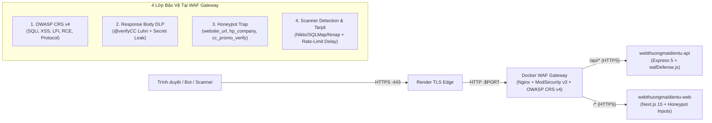

# Thiết Kế Lớp Tường Lửa Ứng Dụng Web (WAF) & Lọc Lộ Lọt Dữ Liệu (DLP)

**Ngày lập:** 2026-11-22  
**Kiến trúc được chọn:** Phương án 1 — Docker Gateway **Nginx + ModSecurity v3 + OWASP Core Rule Set (CRS) v4** trên Render (`webthuongmaidientu-waf`) kết hợp lớp phòng thủ chiều sâu (Defense in Depth) tại Express & Honeypot trên Frontend.

---

## 1. Kiến trúc tổng thể (Defense in Depth)

---

## 2. Chi tiết 4 mũi nhọn bảo mật

### 2.1. WAF Reverse Proxy với OWASP Core Rule Set (CRS v4)
- Sử dụng image chính thức `owasp/modsecurity-crs:nginx` trong [waf/Dockerfile](file:///Users/nguyenhoangduong/web%20thuong%20mai%20dien%20tu/webthuongmaidientu/waf/Dockerfile).
- Chạy ở chế độ chặn chủ động (`MODSEC_RULE_ENGINE=On`, `PARANOIA=1`, `BLOCKING_PARANOIA=1`), ghi Audit Log ra stdout để quan sát trực tiếp trên **Render Logs**.
- **Tinh chỉnh ngoại lệ (False Positive Prevention)** tại `waf/rules/REQUEST-900-EXCLUSION-RULES-BEFORE-CRS.conf`:
  - `POST /api/webhooks/sepay` & `POST /api/webhooks/payment`: Cho phép nội dung chuyển khoản ngân hàng tiếng Việt/ký tự đặc biệt đi qua CRS (đã có lớp xác thực `Authorization: Apikey` + `crypto.timingSafeEqual` ở Backend).
  - `POST /api/images`: Miễn trừ kiểm tra byte nhị phân `multipart/form-data` để không chặn nhầm ảnh upload sản phẩm.
  - `GET /api/orders/:id/events`: Tắt `responseBodyAccess` & `proxy_buffering` để dòng sự kiện SSE hoạt động real-time.

### 2.2. Lọc Lộ Lọt Dữ Liệu Thẻ Tín Dụng (Response Body DLP — `@verifyCC`)
- Tại ModSecurity (`waf/rules/RESPONSE-999-EXCLUSION-RULES-AFTER-CRS.conf`):
  - Bật `MODSEC_RESP_BODY_ACCESS=On` cho `text/html`, `application/json`, `text/plain`.
  - **Rule `100200`**: Dùng toán tử `@verifyCC (?:\d[ -]*?){13,16}` ở `phase:4` (kiểm tra checksum **Luhn** trên toàn bộ `RESPONSE_BODY`). Nếu phát hiện số thẻ thanh toán hợp lệ rò rỉ ra ngoài → chặn ngay bằng `403 Forbidden` và ghi audit log `OWASP_CRS/LEAKAGE/CREDIT_CARD`.
  - **Rule `100201`**: Quét rò rỉ bí mật hệ thống (`mongodb+srv://`, `PRIVATE KEY`, `JWT_SECRET`, `SEPAY_WEBHOOK_API_KEY`).
- Tại Express (`backend/src/middleware/wafDefense.js`):
  - Middleware `creditCardDlpMiddleware` chạy thuật toán kiểm tra **Luhn** trên phản hồi JSON/text như lớp phòng thủ dự phòng (Defense in Depth) ngay cả khi truy cập trực tiếp vào API hoặc chạy bộ test tự động.

### 2.3. Bẫy Bot bằng Trường Form Ẩn Giả Lập (Fake Hidden Form Fields — Honeypot)
- Trên Frontend: Cài trường input ẩn `website_url` (ẩn bằng `position: absolute; left: -9999px; opacity: 0`, `tabIndex={-1}`, `aria-hidden="true"`, `autoComplete="off"`) tại:
  - Trang đặt hàng (`frontend/src/app/checkout/page.jsx`)
  - Trang đăng ký (`frontend/src/app/(auth)/register/page.jsx`)
  - Trang đăng nhập (`frontend/src/app/(auth)/login/page.jsx`)
- Trên ModSecurity (`id:100100`, `id:100101`) & Express (`honeypotGuard`): Nếu bất kỳ trường bẫy nào (`website_url`, `hp_company`, `cc_promo_verify`) chứa dữ liệu khác rỗng → lập tức nhận diện là bot tự động, áp dụng làm chậm (Tarpit) và trả về `403 Forbidden`.

### 2.4. Làm Chậm Công Cụ Quét Tự Động (Scanner Tarpit & Rate Limiting)
- **Nhận diện công cụ quét** (`id:100110` trong ModSecurity + `scannerTarpitGuard` trong Express): Nhận diện chữ ký `sqlmap`, `nikto`, `nmap`, `gobuster`, `dirbuster`, `wpscan`, `nuclei`, `acunetix`, `masscan`, `hydra`, `ffuf`, `wfuzz`, `nessus` → trì hoãn phản hồi (tarpit) và chặn `403`.
- **Nginx `limit_req` Tarpit & Rate Limiting** (`waf/nginx/default.conf.template`):
  - Khu vực xác thực `/api/auth/login`, `/api/auth/register`: Giới hạn `10r/m`, `burst=5` (không dùng `nodelay` ở tầng tarpit để làm chậm hành vi thử mật khẩu).
  - Khu vực tìm kiếm & khuyến mãi `/api/promotions/validate`, `/api/products`: Giới hạn tốc độ quét hàng loạt, trả `429 Too Many Requests` khi vượt ngưỡng.

---

## 3. Triển khai & Kiểm thử
- **Local & CI**: `cd backend && npm test` kiểm chứng toàn bộ luật Honeypot, Scanner Tarpit, Rate Limiter và Luhn Credit Card DLP (`backend/tests/waf-defense.test.js`), đảm bảo không ảnh hưởng 124 bài test hiện có.
- **Render Public**: Deploy Docker service `webthuongmaidientu-waf` qua [render.yaml](file:///Users/nguyenhoangduong/web%20thuong%20mai%20dien%20tu/webthuongmaidientu/render.yaml), kiểm tra trực tiếp bằng `curl -I`, payload SQLi/XSS, User-Agent `Nikto/SQLMap`, và Honeypot field trên link `https://webthuongmaidientu-waf.onrender.com`.
